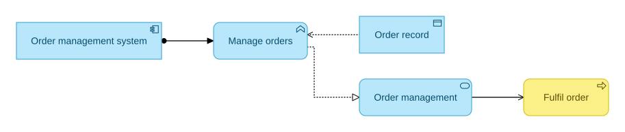

# ArchiMate for Mermaid

[](package.json)
[](LICENSE)
[](https://nodejs.org/)
[](https://github.com/mermaid-js/mermaid/releases/tag/mermaid%4012.3.0)
[](https://publications.opengroup.org/standards/archimate/c226)

Write ArchiMate 3.2 diagrams in plain text, validate their structure in CI, and render them as SVG. This independent Mermaid plugin includes 60 element types, 11 relationship types, relationship-backed nesting, and notes. The `archimate-beta` syntax is experimental.

**Automatic relationship checks against ArchiMate 3.2 Appendix B are under development.** Their release depends on permission from The Open Group to distribute the relationship lookup.



[Quick start](#quick-start) · [Examples](#examples) · [Host integration](#host-integration) · [Language API](#language-api) · [Coverage](#coverage) · [Development](#development) · [Sources](#sources)

## Quick start

Use Node.js 22.12 or later. From a checkout, install dependencies and validate a bundled example.

```sh
npm ci
npm run build
node dist/cli.js validate examples/order-fulfilment.mmd
```

The validator prints every problem it finds as `file:line:column: message`, suggests the closest valid keyword for a misspelt type, and prefixes warnings, such as a repeated shorthand relationship, with `warning:`. It exits with status 1 if there is any error, and with status 0 if there are only warnings. Use `-` as the input path to read from standard input.

To render a standalone SVG, install Playwright's Chromium browser and run the checkout's render command.

```sh
npx playwright install chromium
npm run render -- examples/order-fulfilment.mmd order-fulfilment.svg
```

## Examples

A diagram starts with `archimate-beta`. Give each element and relationship a stable ID, then reference those IDs when connecting or nesting elements.

```text
archimate-beta
  direction LR
  accTitle: Order fulfilment responsibilities
  accDescr: A fulfilment clerk is assigned to the fulfil order process.

  element businessRole clerk "Fulfilment clerk"
  element businessProcess fulfil "Fulfil order"
  relationship assignment clerk_to_fulfil clerk -> fulfil
```

Add element details with `description elementId "Text"` and a visible relationship label with `label "Text"` after the relationship's endpoints and options.

### Relationship shorthand

Write `source <connector> target` to declare a relationship without an ID. Add `: "Text"` for a visible label. The left endpoint is always the model source, so `manage <.. order` means *manage reads order*. The connector mirrors the rendered markers.

| Relationship | Connector | Long form equivalent |
| --- | --- | --- |
| Composition | `a *-- b` | `relationship composition id a -> b` |
| Aggregation | `a o-- b` | `relationship aggregation id a -> b` |
| Assignment | `a @==> b` | `relationship assignment id a -> b` |
| Realization | `a ..\|> b` | `relationship realization id a -> b` |
| Serving | `a --> b` | `relationship serving id a -> b` |
| Access | `a .. b` | `relationship access id a -> b` |
| Access, read | `a <.. b` | `... a -> b access read` |
| Access, write | `a ..> b` | `... a -> b access write` |
| Access, read/write | `a <..> b` | `... a -> b access readWrite` |
| Influence | `a -.-> b` | `relationship influence id a -> b` |
| Association | `a --- b` | `relationship association id a -> b` |
| Association, directed | `a --/ b` | `... a -> b directed` |
| Triggering | `a ==> b` | `relationship triggering id a -> b` |
| Flow | `a -.=> b` | `relationship flow id a -> b` |
| Specialization | `a --\|> b` | `relationship specialization id a -> b` |

`..` is a dotted line and `-.` a dashed one. `>` is an open arrowhead, `=>` a filled one, `|>` a hollow triangle, and `/` the single barb of a directed Association. Shorthand relationships receive generated IDs of the form `source__type__target`. Use the long form when another declaration must reference the relationship by ID.

| Example | What it shows | Files |
| --- | --- | --- |
| Order fulfilment | A Business Role assigned to a Business Process | [Source](examples/order-fulfilment.mmd) |
| Order management | Assignment, Realization, Serving, and read Access | [Source](examples/order-management.mmd) · [SVG](examples/order-management.svg) |
| Cross-layer relationships | Architecture layout with Business, Application, and Technology rows and nested claims processing | [Source](examples/cross-layer-relationships.mmd) · [SVG](examples/cross-layer-relationships.svg) |
| Nested components | Composition shown as containment, edges crossing the boundary, and notes | [Source](examples/nested-components.mmd) · [SVG](examples/nested-components.svg) |
| Notation sheet | The element catalogue and examples of every relationship, including Access and Association variants | [SVG](examples/element-preview.svg) |

### Choose a layout

Architecture layout is the default when you omit both `layout` and `direction`. Use `layout architecture` to select it explicitly. It orders occupied layers from top to bottom as Strategy, Business, Application, Technology (including Physical), and Implementation & Migration. Relationships guide the placement of connected elements within and across layers. Motivation sits at the top, near the chains it connects to.

Use `layout framework` to arrange the same layers in fixed aspect columns. Passive Structure, Behavior, and Active Structure run from left to right, with Motivation on the far right. Only occupied rows and columns take up space.

In architecture and framework layout, relationships of the same type that leave or arrive at the same element share one anchor and run as one line until they branch to their other ends. Access relationships bundle only with the same access mode, and directed Associations only with directed ones. A bundle splits by direction: elements directly above or below get a straight line from that side, and the rest share a trunk from the left or right side. Each relationship type gets its own anchor, and anchors are ordered so that trunks nest without crossing. Branch points are plain line joins, not ArchiMate junctions. Self-relationships and relationships of notes are never bundled.

Architecture and framework layouts preserve nesting. A parent with its own layer determines the placement of its container. Groups without their own layer that contain elements from multiple layers are placed separately.

Use `layout graph` for a relationship-driven layout. Graph layout accepts `direction TB`, `BT`, `LR`, or `RL`, and defaults to `TB`. A `direction` declaration on its own selects graph layout. An explicit `layout` declaration takes precedence.

### Nest elements and add notes

Declare a relationship and give its ID to `nest child in parent via relationshipId`. Omit `via relationshipId` when exactly one relationship between the two elements supports the nesting, as with a shorthand relationship.

```text
archimate-beta
  element applicationComponent suite "Order management suite"
  element applicationComponent billing "Billing"

  relationship composition includes_billing suite -> billing
  nest billing in suite via includes_billing

  note review "Confirm retry behaviour" on suite
```

Nesting supports Composition, Aggregation, Assignment, Realization, and Access from parent to child. For Specialization, the child specializes its parent. The nesting declaration must reference a relationship between the named child and parent. Each child can have one visual parent. The enclosure represents the relationship and the renderer also draws its line when it carries a label or explicit read/write mode. [ArchiMate 3.2 specification, §§3.8, 5.1, 5.2.2, and 5.4.1](https://publications.opengroup.org/standards/archimate/c226)

Use `note id "Text"` for a standalone note or `note id "Text" on elementId` to attach it to an element's top edge (its bottom edge in `direction BT`, so relationships leaving upward stay clear of it). Notes are diagram annotations and can be endpoints of the supported relationship types. Use `\n` for a line break.

## Host integration

Build a local package archive with `npm pack` in the plugin checkout. In your host project, install that archive with Mermaid 12.3.0.

```sh
npm install mermaid@12.3.0 /path/to/archimate-mermaid-0.1.0.tgz
npm exec -- archimate validate diagram.mmd
```

Add a `<div id="diagram"></div>` to your page and run this module through your JavaScript bundler.

```js
import mermaid from 'mermaid';
import { archimate } from 'archimate-mermaid';

mermaid.initialize({ startOnLoad: false, securityLevel: 'strict' });
await mermaid.registerExternalDiagrams([archimate]);

const source = `archimate-beta
  direction LR
  element businessRole clerk "Fulfilment clerk"
  element businessProcess fulfil "Fulfil order"
  relationship assignment clerk_to_fulfil clerk -> fulfil`;

const { svg } = await mermaid.render('order-fulfilment', source);
document.querySelector('#diagram').innerHTML = svg;
```

Live rendering requires a host that registers the external diagram. For GitHub Markdown, commit the `.mmd` source alongside its exported SVG and link to the SVG with ``. This keeps the model reviewable in Git and the image visible to readers. [Mermaid external diagram API](https://mermaid.js.org/config/setup/mermaid/interfaces/Mermaid.html#registerexternaldiagrams)

The standalone validator skips a leading YAML frontmatter block that starts and ends with a `---` line, and it reports line numbers for the whole file. It does not read the frontmatter's content, so use the DSL's `title:`, `accTitle:`, and `accDescr:` declarations for metadata the validator should check. Use `accDescr { … }` for a description that spans several lines, and do not combine it with `accDescr:`. A `%%` that follows a space ends a `title:`, `accTitle:` or `accDescr:` value as a comment. To keep it, or to use escapes such as `\u0025`, write the whole value as one double-quoted string, for example `title: "Load %% budget"`. To show a Mermaid directive as literal text in a quoted label, escape its percent signs as `\u0025`.

### Theme, palette, and viewport

The ArchiMate palette controls element colours and is selected independently of the Mermaid theme. Modern is the default and currently available palette. Classic and New are planned as separate palettes.

Light and dark diagrams share the same element fills. Dark mode draws relationship lines and markers in white. Set `theme: 'dark'` when initializing Mermaid, or set `config.theme` in Mermaid YAML frontmatter for an individual diagram.

```text
---
config:
  theme: dark
---
archimate-beta
  element applicationComponent billing "Billing"
```

With `theme: 'base'`, the diagram reads `background`, `lineColor`, `textColor`, `fontFamily` and `fontSize` from `themeVariables`, so its canvas, font and font size follow Mermaid's base theme instead of the ArchiMate presets. The background may be any CSS colour, including named colours and colours with an alpha channel. Dark mode follows `themeVariables.darkMode`, or the brightness of `background` when `darkMode` is not set. A transparent, partly transparent or unrecognised background keeps the ArchiMate light or dark preset for both the canvas and the lines and text. Line and text colours that would be unreadable on the background are replaced by the preset colours. `fontFamily` accepts family names made of letters, digits, spaces, hyphens and underscores, separated by commas and optionally quoted. `fontSize` is limited to 8–32 pixels. Other themes use the ArchiMate light or dark presets.

The `archimate` export uses the Modern palette and 24 pixels of outer diagram padding. It fits narrow containers up to the SVG's natural width. To set palette and viewport options, register an instance from `createArchiMatePlugin`.

```js
import mermaid from 'mermaid';
import { createArchiMatePlugin } from 'archimate-mermaid';

mermaid.initialize({ startOnLoad: false, securityLevel: 'strict', theme: 'dark' });
await mermaid.registerExternalDiagrams([
  createArchiMatePlugin({ palette: 'modern', diagramPadding: 32, useMaxWidth: true }),
]);
```

`diagramPadding` accepts any finite, nonnegative number. `useMaxWidth` defaults to `true`. Set it to `false` to render the SVG at its natural size.

`maxRowWidth` sets the widest row, in pixels, that architecture layout places before wrapping a row onto a second line in the same layer. It accepts any number greater than 0 and defaults to 1200. Set it to `Infinity` to turn wrapping off.

`background` is `'theme'` (default), which paints the diagram canvas in the theme background, or `'transparent'`, which omits the canvas so the host page shows through. Relationship labels and hollow markers keep the theme background in both cases.

Element names wrap at about 200 pixels and relationship labels at about 180 pixels. ELK, which lays out `layout graph` diagrams, loads on demand the first time one is rendered.

## Language API

Use the language entry point to validate or inspect a diagram in Node.js without a browser.

```js
import { readFile } from 'node:fs/promises';
import { parseArchiMate } from 'archimate-mermaid/language';

const source = await readFile('diagram.mmd', 'utf8');
const model = parseArchiMate(source);
console.log(model.elements);
```

Validation errors throw `ArchiMateError` with a code, line, and column. `parseArchiMate` stops at the first error.

For editors and linters, `validateArchiMate(source, options)` returns `{ model, diagnostics }`. It reports every semantic error, and warnings such as `DUPLICATE_RELATIONSHIP`, each with `code`, `severity`, `message`, `line`, `column`, `endLine` and `endColumn`. Lines and columns are 1-based and `endColumn` is exclusive. `model` is present only when there are no errors.

The same entry point exports `elementTypes`, `relationshipTypes` and `relationshipNames` for tooling that needs the catalogue.

## Coverage

The renderer supports the default figures for all 60 concrete elements and all 11 relationship types in the bundled catalogue. Access accepts `access read`, `access write`, `access readWrite`, or `access unspecified`. Use `directed` for a directed Association. [Notation preview](examples/element-preview.svg)

The validator checks syntax, declared endpoints, supported element and relationship types, relationship options, and nesting. Check the specification to verify which element types a relationship can connect. [ArchiMate 3.2 specification, Appendix B](https://publications.opengroup.org/standards/archimate/c226)

Junctions, relationship-to-relationship endpoints, alternative element figures, viewpoint tooling, and model exchange are outside the current scope.

## Development

```sh
npm ci
npm test
npx playwright install chromium
npm run test:browser
npm pack --dry-run
```

Use `npm run typecheck` to check TypeScript without emitting files and `npm run render:preview` to regenerate the notation sheet. The browser tests exercise the plugin through a real Mermaid host.

For contributions, check the design notes, update tests for language or rendering changes, and include a minimal diagram when reporting a problem. To generate or edit diagrams with an agent, point it to the repository skill. It covers syntax, relationship direction, and validation commands. [Foundation](FOUNDATION.md) · [Agent skill](skills/archimate-mermaid/SKILL.md)

## Sources

- The Open Group's ArchiMate 3.2 specification defines the element and relationship types. [Specification C226](https://publications.opengroup.org/standards/archimate/c226)
- The Open Group's reference cards illustrate element figures and relationship notation. [Reference cards N221](https://www.opengroup.org/sites/default/files/docs/downloads/n221p.pdf)
- The catalogue records the Archi 3.2 reference fills. The renderer defines its display palette separately. [Archi palette](https://www.archimatetool.com/downloads/colour-schemes/ArchiMate%20Standard%20-%203.2.prefs)
- Mermaid provides the external diagram API, and ELK provides the graph layout. [Mermaid diagram guide](https://mermaid.js.org/community/new-diagram.html) · [ELK](https://eclipse.dev/elk/)

The plugin code is licensed under the [MIT License](LICENSE). The ArchiMate specification has [separate licensing terms](https://www.opengroup.co.za/standards). ArchiMate® is a registered trademark of The Open Group.
